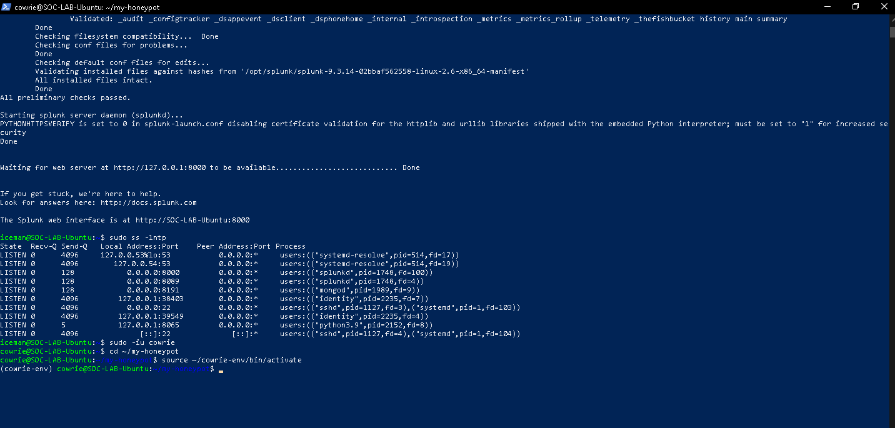
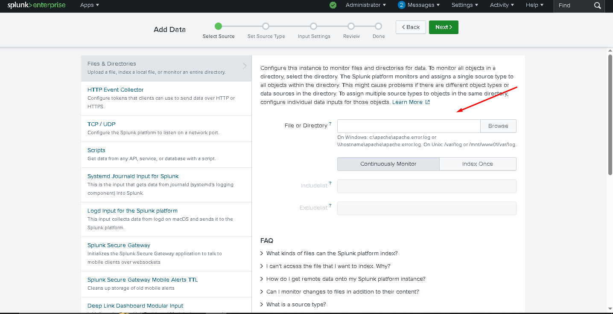
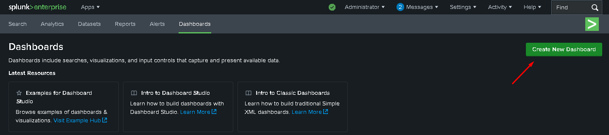
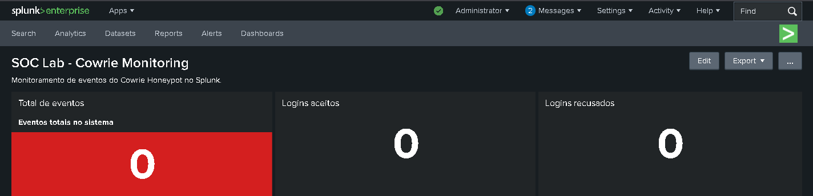
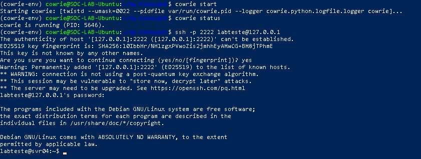
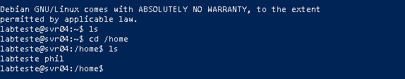
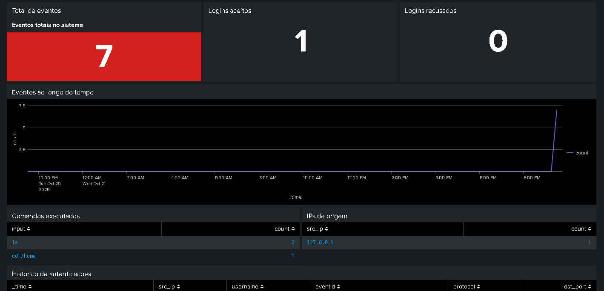
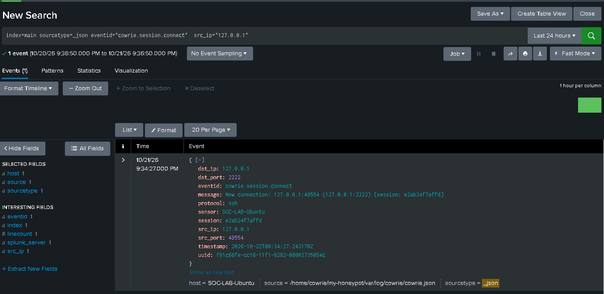
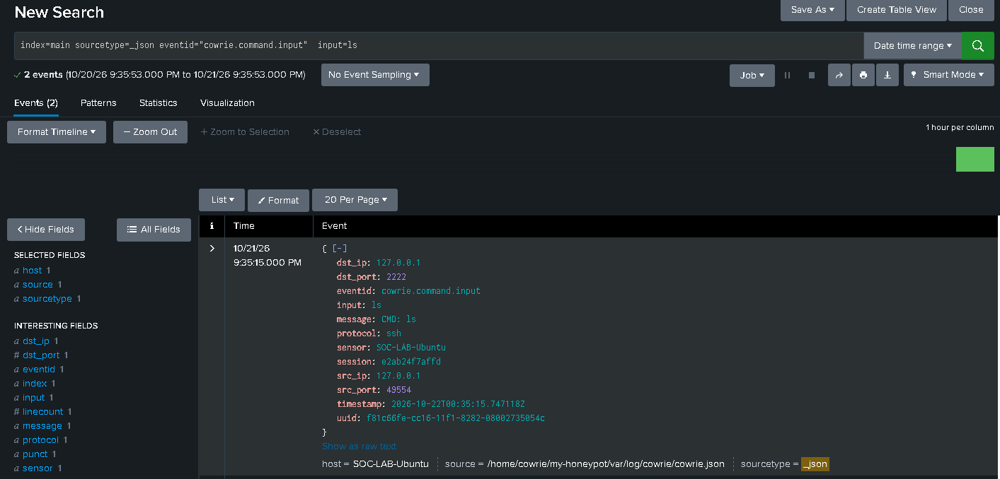

# 🛡️ Laboratório Prático de Cibersegurança: Centralização e Análise de Logs com Cowrie Honeypot e Splunk Enterprise

## 📌 Visão Geral do Projeto

Este projeto consiste na criação de um **ambiente de laboratório prático de cibersegurança** rodando localmente em uma máquina virtual **Ubuntu Server** no **Oracle VirtualBox**. 

O objetivo principal é simular ataques de força bruta e execução de comandos maliciosos via SSH através do **Cowrie Honeypot**, centralizar esses logs de eventos em tempo real no **Splunk Enterprise** (SIEM) e criar um **Dashboard interativo** para análise visual rápida dos incidentes.

---

## 🏗️ Arquitetura do Laboratório

1. **Virtualization:** Oracle VirtualBox (Ubuntu Server).
2. **Honeypot (Cowrie):** Simula um servidor SSH interativo na porta `2222` para capturar tentativas de login, IPs de atacantes, credenciais testadas e comandos executados.
3. **SIEM / Log Analytics (Splunk Enterprise):** Ingestão, indexação, consulta via **SPL** (*Search Processing Language*) e visualização estruturada dos logs de segurança em formato JSON.

---

## 🚀 Passo a Passo da Configuração

### 1. Ajuste e Execução do Cowrie Honeypot

Após a instalação do Splunk Enterprise e do Cowrie na máquina virtual, o serviço do Cowrie foi configurado para rodar na porta alternativa **`2222`**, evitando conflitos com o serviço SSH real da máquina host/servidor.

> **Como o Cowrie funciona?**  
> O Cowrie emula um ambiente shell vulnerável. Quando uma conexão é estabelecida, ele armazena todas as sessões, tentativas de autenticação e histórico de comandos em um arquivo estruturado no formato **JSON**, facilitando o parsing e a leitura por ferramentas de SIEM.

---

### 2. Configuração do Ingestion (Data Input) no Splunk

Para que o Splunk monitore e colete continuamente os dados gerados pelo honeypot, adicionamos um novo **Data Input (Monitor)** apontando diretamente para o arquivo de log JSON do Cowrie.

* **Caminho monitorado:** `/home/cowrie/my-honeypot/var/log/cowrie/cowrie.json`

A partir dessa configuração, qualquer nova interação registrada no honeypot é instantaneamente indexada pelo Splunk, ficando disponível para consultas avançadas com SPL.

---

### 3. Criação do Dashboard em XML

Para transformar logs brutos em inteligência visual e facilitar o acompanhamento de incidentes, criamos um **Dashboard personalizado** no Splunk.

O Splunk permite definir layouts e painéis estruturados de forma simples, utilizando código **XML** para customizar a interface visual.

---

### 4. Simulação de Ataque e Geração de Eventos

Com a coleta de logs ativa e a interface configurada, iniciamos o Cowrie e simulamos uma conexão SSH a partir do ambiente local para validar a captura.

* **Usuário utilizado na simulação:** `LABTESTE`
* **Destino:** Loopback / IP local da VM (porta 2222)

Como o Honeypot está em modo de captura padrão, a sessão é estabelecida. Em seguida, foram executados vários comandos simulados (como `ls`, `whoami`, `cat`, entre outros) para gerar uma amostragem de dados representativa.

---

### 5. Análise de Logs e Investigação no Splunk

Voltando ao Splunk, podemos observar os novos eventos já refletidos nos gráficos e tabelas do Dashboard em tempo real.

O painel exibe detalhes valiosos para resposta a incidentes, incluindo:
* IP de origem da conexão.
* Comandos exatos inseridos na sessão.
* Timestamp e porta utilizada.

#### Detalhamento do Evento (SPL)

Ao clicar sobre um evento específico, é possível inspecionar a consulta **SPL** gerada e visualizar a estrutura completa da mensagem enviada pelo Cowrie.

Na imagem acima, vemos o evento bruto que confirma o sucesso da conexão SSH, destacando o IP de origem e a porta remota utilizada.

#### Monitoramento de Comandos Executados

No painel de histórico do Dashboard, conseguimos mapear a linha do tempo das ações executadas pelo "atacante" dentro da máquina virtual:

> **Exemplo:** O registro do comando `ls` utilizado para listar diretórios dentro da sessão emulada.

---

## 🎯 Considerações Finais

A construção deste laboratório permitiu consolidar conceitos fundamentais de **Defesa Cibernética (Blue Team)**, **Enganação (Deception Systems)** e **Análise de Logs (SIEM)**.

### Principais Aprendizados:
* **Comportamento do Atacante:** A utilização de Honeypots como o Cowrie oferece uma visão clara e segura da fase de reconhecimento e movimentação de um atacante em uma rede.
* **Centralização de Logs:** A ingestão automática de arquivos JSON no Splunk otimiza o tempo de detecção, eliminando a necessidade de análise manual de arquivos diretamente no servidor.
* **Visualização Estruturada:** A criação de dashboards em XML e o uso de SPL transformam volume bruto de dados em métricas acionáveis, essenciais para o monitoramento contínuo de segurança (SOC).
